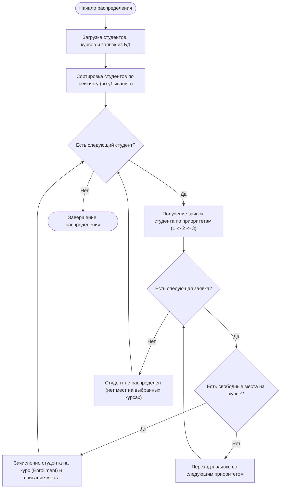
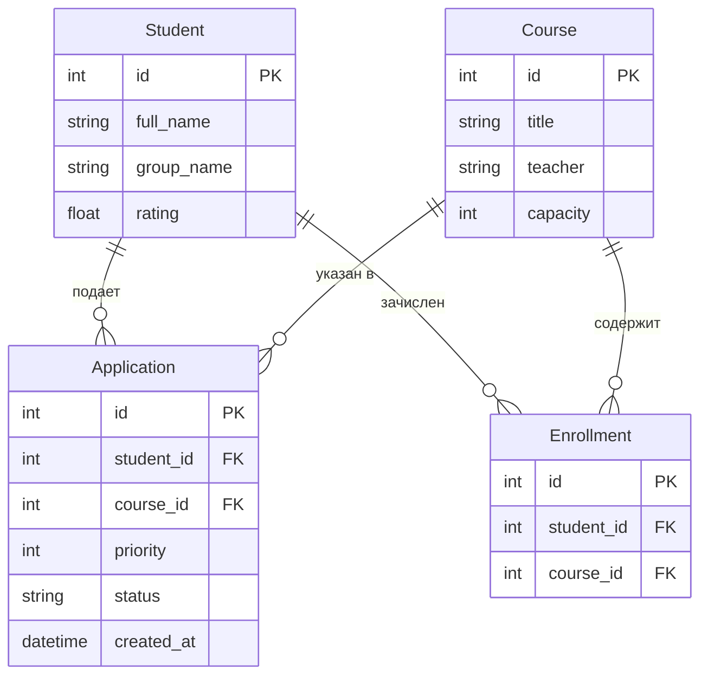
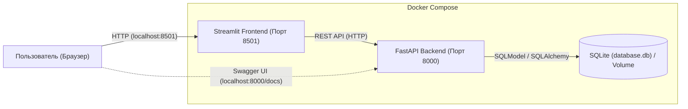

# АРМ Замдекана: модуль распределения элективных курсов

**Автор:** [ФИО, группа]

## Описание предметной области
Модуль автоматизирует процесс выбора и распределения студентов по элективным дисциплинам в высшем учебном заведении. Студенты подают заявки на желаемые курсы с указанием приоритетов (от 1 до 3), выражая свои академические предпочтения. Процесс распределения учитывает академическую успеваемость: студенты с более высоким рейтингом получают приоритет при зачислении на популярные дисциплины с ограниченной вместимостью. Система позволяет замдекана и сотрудникам деканата исключить ручную обработку сотен заявлений, минимизировать конфликты и обеспечить прозрачность конкурсного отбора. При исчерпании лимита мест на курсе первого приоритета алгоритм автоматически рассматривает альтернативные курсы из заявки студента.

## Алгоритм распределения
1. **Сортировка студентов**: Студенты сортируются по рейтингу по убыванию (студенты с наивысшим рейтингом рассматриваются в первую очередь).
2. **Обработка приоритетов**: Для каждого студента последовательно рассматриваются заявки в порядке приоритета: `1` → `2` → `3`.
3. **Зачисление**: При наличии свободных мест на выбранном курсе студент зачисляется на курс. Если места закончились, система переходит к рассмотрению заявки со следующим приоритетом.



## Технологический стек
- **Python 3.12** — основной язык разработки
- **FastAPI** — высокопроизводительный веб-фреймворк для реализации REST API
- **SQLModel** — библиотека для описания моделей данных и работы с БД (на базе SQLAlchemy и Pydantic)
- **Streamlit** — интерактивный веб-интерфейс пользователя
- **Docker & Docker Compose** — контейнеризация и оркестрация микросервисной архитектуры
- **Pytest & HTTPX** — автоматизированное тестирование API

## ER-диаграмма данных



### Описание сущностей и таблиц
- **`Student` (Студенты)**: хранит персональные данные обучающегося — идентификатор `id`, ФИО (`full_name`), академическую группу (`group_name`) и текущий рейтинг (`rating`), используемый при распределении.
- **`Course` (Элективные курсы)**: содержит каталог доступных дисциплин — идентификатор `id`, название (`title`), преподавателя (`teacher`) и максимальную вместимость группы (`capacity`).
- **`Application` (Заявки)**: фиксирует выбор студента — идентификатор `id`, внешние ключи `student_id` и `course_id`, приоритет выбора `priority` (от 1 до 3), статус обработки `status` (`new`, `approved`, `rejected`) и время подачи `created_at`.
- **`Enrollment` (Зачисления)**: итоговый результат распределения — идентификатор `id`, связь зачисленного студента `student_id` и курса `course_id`.

## Архитектура системы



## Структура проекта
```text
elective-distribution-2026/
├── app/
│   ├── __init__.py
│   ├── main.py              # Точка входа FastAPI приложения
│   ├── models.py            # Описание моделей данных (SQLModel)
│   ├── schemas.py           # Схемы валидации данных (Pydantic / DTO)
│   ├── database.py          # Настройка подключения к базе данных и сессий
│   ├── api/                 # Маршруты и обработчики REST API
│   │   ├── __init__.py
│   │   ├── students.py      # Управление данными студентов
│   │   ├── courses.py       # Управление элективными курсами
│   │   └── applications.py  # Обработка заявок студентов
│   ├── frontend/            # Пользовательский интерфейс внутри модуля
│   │   └── app.py           # Streamlit приложение
│   └── services/            # Бизнес-логика приложения
│       ├── __init__.py
│       └── distribution.py  # Реализация алгоритма распределения
├── frontend/
│   └── app.py               # Точка входа Streamlit приложения
├── tests/
│   ├── conftest.py          # Настройка тестового окружения (in-memory SQLite, фикстуры)
│   └── test_api.py          # Модульные и интеграционные тесты API
├── Dockerfile               # Сборка образа бэкенда FastAPI
├── Dockerfile.frontend      # Сборка образа фронтенда Streamlit
├── docker-compose.yml       # Конфигурация запуска сервисов в Docker
├── .dockerignore            # Исключения файлов для Docker
├── .gitignore               # Исключения файлов для Git
├── requirements.txt         # Список внешних зависимостей проекта
├── seed.py                  # Скрипт наполнения базы начальными данными
└── README.md                # Документация проекта
```

## Инструкция по запуску

### Запуск через Docker Compose (рекомендуемый)
1. Выполните сборку и запуск контейнеров:
   ```bash
   docker-compose up --build
   ```
2. Откройте сервисы в браузере:
   - **Streamlit веб-интерфейс**: [http://localhost:8501](http://localhost:8501)
   - **Документация API (Swagger UI)**: [http://localhost:8000/docs](http://localhost:8000/docs)
3. Остановка контейнеров:
   ```bash
   docker-compose down
   ```

### Локальный запуск (без Docker)
1. Активируйте виртуальное окружение:
   ```powershell
   venv\Scripts\activate
   ```
2. Инициализируйте тестовые данные (при необходимости):
   ```bash
   python seed.py
   ```
3. Запустите бэкенд:
   ```bash
   python -m uvicorn app.main:app --host 127.0.0.1 --port 8000 --reload
   ```
4. В отдельном терминале запустите фронтенд:
   ```bash
   streamlit run app/frontend/app.py
   ```

## Запуск тестов
Для запуска автоматических тестов API выполните:
```bash
venv\Scripts\python -m pytest -v
```
или:
```bash
pytest -v
```
