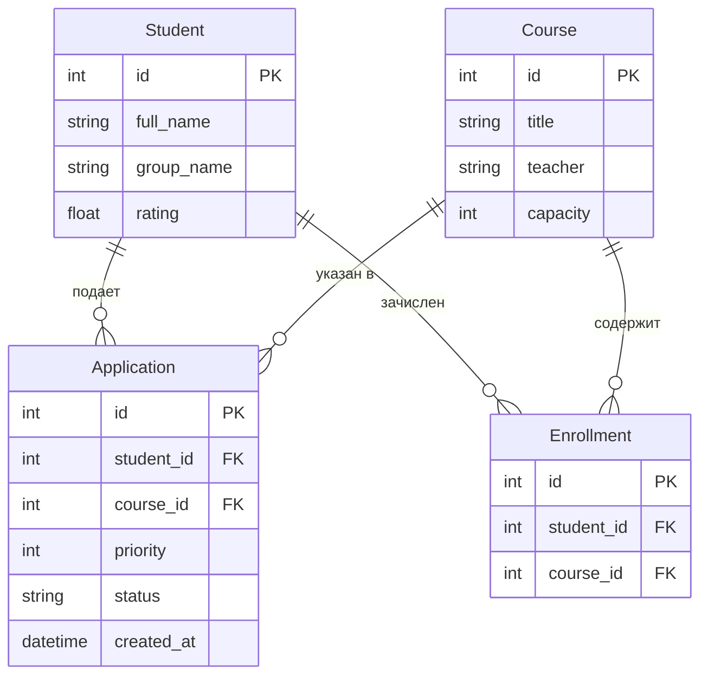

# АРМ Замдекана: модуль распределения элективных курсов

## Описание
Автоматизированное рабочее место (АРМ) замдекана для распределения студентов по элективным курсам на основе их академического рейтинга и указанных приоритетов выбора.

## Алгоритм распределения
1. **Сортировка студентов**: Студенты сортируются по рейтингу по убыванию (студенты с наивысшим рейтингом рассматриваются в первую очередь).
2. **Обработка приоритетов**: Для каждого студента последовательно рассматриваются заявки в порядке приоритета: `1` → `2` → `3`.
3. **Зачисление**: При наличии свободных мест на выбранном курсе студент зачисляется на курс. Если места закончились, система переходит к рассмотрению заявки со следующим приоритетом.

## Стек технологий
- **Python 3.12** — основной язык разработки
- **FastAPI** — высокопроизводительный веб-фреймворк для реализации REST API
- **SQLModel** — библиотека для описания моделей данных и работы с БД (на базе SQLAlchemy и Pydantic)
- **Streamlit** — интерактивный веб-интерфейс пользователя

## Структура проекта
```text
elective-distribution-2026/
├── app/
│   ├── __init__.py
│   ├── main.py              # Точка входа FastAPI приложения
│   ├── models.py            # Описание моделей данных (SQLModel)
│   ├── database.py          # Настройка подключения к базе данных и сессий
│   ├── api/                 # Маршруты и обработчики REST API
│   │   ├── __init__.py
│   │   ├── students.py      # Управление данными студентов
│   │   ├── courses.py       # Управление элективными курсами
│   │   └── applications.py  # Обработка заявок студентов
│   └── services/            # Сервисный слой и бизнес-логика
│       ├── __init__.py
│       └── distribution.py  # Реализация алгоритма распределения
├── frontend/
│   └── app.py               # Пользовательский веб-интерфейс на Streamlit
├── requirements.txt         # Список внешних зависимостей проекта
└── README.md                # Документация проекта
```

## ER-диаграмма данных


