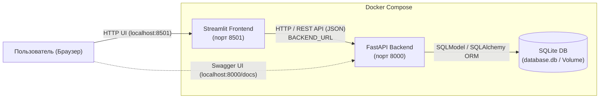

# Архитектура системы «АРМ Замдекана: модуль распределения элективных курсов»

## 1. Схема взаимодействия компонентов

Архитектура построена по классической многозвенной схеме с разделением на клиентский уровень представления (Streamlit), сервисный уровень API и бизнес-логики (FastAPI) и уровень хранения данных (SQLite). Все компоненты разворачиваются и оркестрируются через Docker Compose.

---

## 2. Анализ компонентов системы

| Компонент | Роль в системе | Возможные ошибки (минимум 2) | Нужен ли интеграционный тест |
| :--- | :--- | :--- | :---: |
| **Streamlit Frontend** | Веб-интерфейс пользователя (замдекана/методиста): ввод данных, фильтрация списков курсов и заявок, отображение таблиц и отправка запросов на бэкенд. | 1. `RequestException` / `ConnectionError` — бэкенд недоступен или не отвечает по таймауту. 2. Ошибки рендеринга данных при получении неожиданного формата ответа от API (например, пустой или повреждённый JSON). | **Да** (проверка доступности и сквозного сценария загрузки данных из FastAPI) |
| **FastAPI Backend** | Маршрутизация REST API, валидация входных данных через Pydantic (схемы DTO), исполнение бизнес-логики, сериализация ответов. | 1. `HTTP 422 Unprocessable Entity` — нарушение валидации входных параметров (неверный тип, пустое название, некорректный рейтинг/вместимость). 2. `HTTP 409 Conflict` — попытка удаления курса при наличии связанных заявок или создание дублирующей заявки. | **Да** (ключевой объект тестирования: проверка кодов 200, 201, 404, 409, 422, логики фильтрации и CRUD) |
| **SQLModel / SQLAlchemy ORM** | Объектно-реляционное отображение, транзакционное управление сессиями (`Session`), построение безопасных параметризованных SQL-запросов. | 1. `IntegrityError` — нарушение ограничений схемы БД (UNIQUE, NOT NULL, FOREIGN KEY). 2. `OperationalError` / блокировка базы данных при конкурентном доступе к SQLite. | **Да** (проверка корректного открытия, коммита и отката (rollback) транзакций при сбоях) |
| **SQLite Database** | Локальное реляционное хранилище данных, смонтированное через Docker Volume для персистентности между перезапусками. | 1. Повреждение или блокировка файла базы (`database is locked`) при параллельных транзакциях. 2. Отсутствие принудительной проверки внешних ключей без включённой директивы `PRAGMA foreign_keys=ON`. | **Да** (проверка целостности связей Student → Application / Enrollment и Course → Application / Enrollment) |
| **Docker Compose** | Инфраструктурная изоляция сервисов, проброс портов (8000, 8501), организация внутренней сети и сохранение volumes. | 1. Сбой связи по внутренней сети контейнеров (например, неверный `BACKEND_URL=http://backend:8000`). 2. Потеря данных при удалении контейнеров, если volume для базы данных не смонтирован или настроен с ошибкой. | **Да** (smoke-тест `docker-compose up --build` с проверкой доступности обоих сервисов) |

---

## 3. Потоки данных

1. **Запрос на просмотр данных (GET /courses, GET /applications):**
   - Пользователь вводит параметры фильтрации в Streamlit UI.
   - Streamlit отправляет HTTP GET запрос на `http://backend:8000/courses` с query-параметрами.
   - FastAPI валидирует параметры, строит запрос через `select(Course).where(...)` и запрашивает данные из SQLite.
   - SQLite возвращает строки, SQLModel трансформирует их в Pydantic-модели и отдаёт JSON-ответ.
   - Streamlit рендерит таблицу в виде интерактивного датафрейма.

2. **Запрос на модификацию данных (POST, PATCH, DELETE):**
   - Пользователь заполняет форму в Streamlit и отправляет данные.
   - FastAPI проверяет валидность данных схемами (`CourseCreate`, `CourseUpdate`, `ApplicationCreate`).
   - При отсутствии ошибок открывается транзакция сессии, данные записываются в БД, фиксируются (`session.commit()`) и возвращается созданный/изменённый объект со статусом `201` или `200`.
   - В случае ошибок валидации возвращается `422`, при бизнес-конфликтах (например, удаление курса с заявками) — `409`, при отсутствии объекта — `404`.
